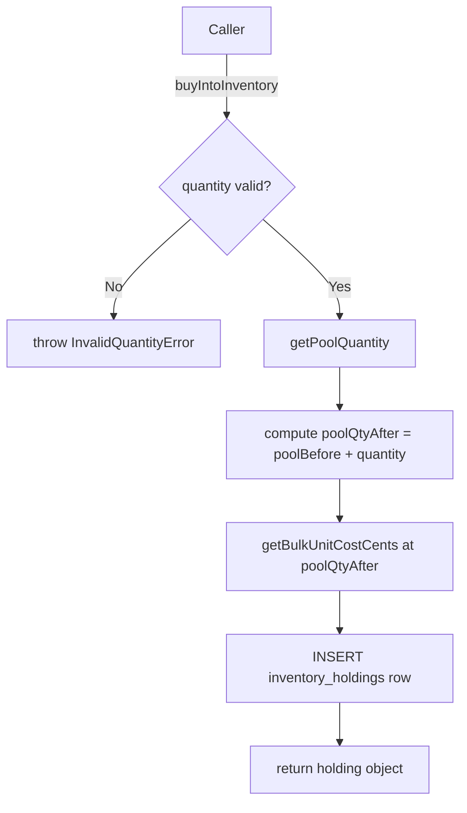

# Design Document: buy-into-inventory

## Overview

`buyIntoInventory` is a synchronous, pure-domain function that records one buyer's purchase of units into their inventory. It validates the requested quantity, computes the applicable bulk-tier unit cost using the post-purchase pool size, writes one row to `inventory_holdings`, and returns the full details of the new holding.

The function is a single exported symbol in `server/src/models/inventory.js`. All collaborating DB primitives (`getPoolQuantity`, `getBulkUnitCostCents`) are already implemented in `server/src/models/product.js`. No network calls, no async I/O — `better-sqlite3` is entirely synchronous.

## Architecture

The feature lives entirely in the **model layer**. The call flow is:

```
Caller
  └─► buyIntoInventory(db, productId, buyerUserId, quantity)
        ├─ [guard] InvalidQuantityError if quantity invalid
        ├─ getPoolQuantity(db, productId)          ← product.js
        ├─ getBulkUnitCostCents(db, productId, poolQtyAfter)  ← product.js
        ├─ db.prepare(INSERT INTO inventory_holdings ...).run(...)
        └─ return { id, userId, productId, quantity, unitCostCents, totalCostCents, createdAt }
```

No transaction wrapper is needed: the function performs a single INSERT and reads before it are non-mutating queries. If the INSERT fails (e.g., FK violation), `better-sqlite3` throws synchronously and no partial state is written.



## Components and Interfaces

### `InvalidQuantityError` (class)

```js
class InvalidQuantityError extends Error {
  constructor(message) {
    super(message);
    this.name = 'InvalidQuantityError';
  }
}
```

- Extends `Error`.
- `name` is always `'InvalidQuantityError'` (not `'Error'`).
- `message` includes `JSON.stringify(quantity)` so the bad value is visible.
- Thrown before any DB interaction.

### `buyIntoInventory(db, productId, buyerUserId, quantity)` (function)

| Parameter | Type | Constraint |
|---|---|---|
| `db` | `better-sqlite3 Database` | Open, migrated connection |
| `productId` | `integer` | Must exist in `products` |
| `buyerUserId` | `string` | Stored verbatim; not validated beyond being present |
| `quantity` | `integer` | `Number.isInteger(quantity) && quantity >= 1` |

**Return value:**

```js
{
  id: number,            // lastInsertRowid from better-sqlite3
  userId: string,        // === buyerUserId
  productId: number,     // === productId
  quantity: number,      // === quantity (validated)
  unitCostCents: number, // integer cents from tier lookup
  totalCostCents: number,// unitCostCents * quantity (integer)
  createdAt: string,     // new Date().toISOString()
}
```

**Collaborators (read-only, no side effects):**

| Function | Source | Purpose |
|---|---|---|
| `getPoolQuantity(db, productId)` | `product.js` | Returns current sum of `inventory_holdings.quantity` for the product |
| `getBulkUnitCostCents(db, productId, poolQtyAfter)` | `product.js` | Returns `unit_cost_cents` of the highest `min_qty ≤ poolQtyAfter` tier |

## Data Models

### `inventory_holdings` table (existing schema)

```sql
CREATE TABLE IF NOT EXISTS inventory_holdings (
  id              INTEGER PRIMARY KEY,
  user_id         TEXT    NOT NULL,
  product_id      INTEGER NOT NULL REFERENCES products(id),
  quantity        INTEGER NOT NULL CHECK(quantity >= 1),
  unit_cost_cents INTEGER NOT NULL CHECK(unit_cost_cents >= 1),
  created_at      TEXT    NOT NULL
);
```

One row is inserted per `buyIntoInventory` call. The `id` is SQLite's auto-assigned `lastInsertRowid`.

### Seed state (test baseline)

After `seed(db)` on an in-memory DB:

| Field | Value |
|---|---|
| Product ID | `1` |
| Pool quantity | `30` (3 holdings × 10 units) |
| Base tier | `min_qty = 1`, `unit_cost_cents = 1500` |
| Bulk tier | `min_qty = 50`, `unit_cost_cents = 1000` |

Tier boundary: pool must reach **50** (inclusive) to unlock the 1000¢ tier.

### Key formulas (per business rules)

```
poolQtyAfter   = getPoolQuantity(db, productId) + quantity
unitCostCents  = getBulkUnitCostCents(db, productId, poolQtyAfter)   // integer
totalCostCents = unitCostCents * quantity                             // integer
```

No floating-point arithmetic at any step. `getBulkUnitCostCents` returns an integer column value from SQLite. Multiplication of two integers is an integer in JavaScript (for values in this domain — quantities up to reasonable inventory size never overflow a 53-bit safe integer).

## Correctness Properties

*A property is a characteristic or behavior that should hold true across all valid executions of a system — essentially, a formal statement about what the system should do. Properties serve as the bridge between human-readable specifications and machine-verifiable correctness guarantees.*

### Property 1: Invalid quantity always throws before DB access

*For any* value that is not a positive integer (zero, negative integers, floats, strings, `null`, `undefined`), calling `buyIntoInventory` with that value as `quantity` SHALL throw an error whose `.name` equals `'InvalidQuantityError'`.

**Validates: Requirements 1.1, 1.2, 1.4, 1.5, 1.6, 1.7**

### Property 2: unitCostCents always matches the tier resolved at poolBefore + quantity

*For any* positive integer `quantity` in [1, 100], the `unitCostCents` in the returned holding SHALL equal `getBulkUnitCostCents(db, productId, poolBefore + quantity)` where `poolBefore` is the value of `getPoolQuantity` captured immediately before the call. `unitCostCents` SHALL be an integer (i.e., `Number.isInteger(result.unitCostCents)` is `true`).

**Validates: Requirements 2.1, 2.2, 3.1, 3.2**

### Property 3: Inserted DB row always matches the returned holding

*For any* positive integer `quantity` in [1, 100], after `buyIntoInventory` returns, querying `inventory_holdings` by the returned `id` SHALL yield a row where `user_id`, `product_id`, `quantity`, `unit_cost_cents`, and `created_at` all equal the corresponding fields of the returned object.

**Validates: Requirements 4.1, 4.2, 4.3, 5.2, 5.3, 5.4, 5.5, 5.6**

### Property 4: totalCostCents is always unitCostCents × quantity, and is an integer

*For any* positive integer `quantity` in [1, 100], `result.totalCostCents` SHALL equal `result.unitCostCents * result.quantity`, and `Number.isInteger(result.totalCostCents)` SHALL be `true`.

**Validates: Requirements 5.1**

### Property 5: Pool grows by exactly quantity after a successful call

*For any* positive integer `quantity` in [1, 100], after `buyIntoInventory` returns successfully, `getPoolQuantity(db, productId)` SHALL equal the pool quantity captured before the call plus `quantity`.

**Validates: Requirements 6.1**

## Error Handling

| Condition | Error class | Thrown before DB? | Message includes |
|---|---|---|---|
| `quantity` is `0` | `InvalidQuantityError` | Yes | stringified value |
| `quantity` is negative | `InvalidQuantityError` | Yes | stringified value |
| `quantity` is a float | `InvalidQuantityError` | Yes | stringified value |
| `quantity` is a non-numeric type | `InvalidQuantityError` | Yes | stringified value |
| No tier found for product | `Error` (from `getBulkUnitCostCents`) | No | product id + pool qty |
| SQLite constraint violation | Native `better-sqlite3` error | No | SQLite message |

No error wrapping is applied to errors from `getBulkUnitCostCents` or SQLite — they propagate as-is to the caller.

## Testing Strategy

**Framework:** `node:test` (built-in, no extra dependency) + `fast-check` (already in `devDependencies` at `^4.10.2`). CommonJS modules throughout.

**Test file:** `server/test/inventory.test.js`

**Setup:** Every test creates a fresh `getDb(':memory:')` + `seed(db)`. This guarantees isolation and a known starting pool of 30.

### Unit tests (example-based)

These cover concrete scenarios and boundary conditions:

| Test | Input | Expected |
|---|---|---|
| Normal buy-in, base tier | quantity = 5 (pool → 35) | unitCostCents = 1500, totalCostCents = 7500 |
| Exact tier boundary | quantity = 20 (pool → 50) | unitCostCents = 1000, totalCostCents = 20000 |
| Sequential buys, second crosses boundary | buy 1 (pool 31), then buy 20 (pool 51) | second: unitCostCents = 1000 |
| quantity = 0 | — | throws InvalidQuantityError |
| quantity = -1 | — | throws InvalidQuantityError |
| quantity = 1.5 | — | throws InvalidQuantityError |
| quantity = '5' | — | throws InvalidQuantityError |
| Pool growth | buy 10 (pool → 40) | getPoolQuantity returns 40 |

### Property-based tests (fast-check, `numRuns: 200`)

Each property test uses `fc.integer({ min: 1, max: 100 })` to generate quantities. The DB is reset to seed state before each test suite but **not** between individual property runs within a suite — a fresh in-memory DB is created per `test()` block to prevent pool accumulation across runs.

| Property | Generator | Assertion |
|---|---|---|
| Property 1: invalid qty throws | `fc.oneof(fc.constant(0), fc.integer({ max: -1 }), fc.float().filter(x => !Number.isInteger(x)), fc.string())` | `.name === 'InvalidQuantityError'` |
| Property 2: unitCostCents matches tier | `fc.integer({ min: 1, max: 100 })` | `result.unitCostCents === getBulkUnitCostCents(db, 1, poolBefore + qty)` and `Number.isInteger(result.unitCostCents)` |
| Property 3: DB row matches return | `fc.integer({ min: 1, max: 100 })` | row from DB equals returned object fields |
| Property 4: totalCostCents correct | `fc.integer({ min: 1, max: 100 })` | `totalCostCents === unitCostCents * quantity` and integer |
| Property 5: pool grows by quantity | `fc.integer({ min: 1, max: 100 })` | `getPoolQuantity after === poolBefore + qty` |

**Tag format:** `// Feature: buy-into-inventory, Property N: <property_text>`

**PBT configuration:** Each `fc.assert` call sets `{ numRuns: 200 }`.

**Dual approach:** Unit tests catch concrete bugs at known boundaries (tier boundary at 50, zero/negative/float rejection). Property tests verify universal invariants across the entire valid input range, catching off-by-one errors in pool arithmetic and integer-safety violations.
