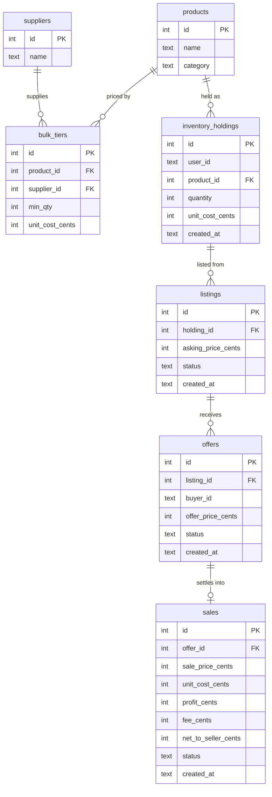

# Design Document

## Overview

This document describes the technical design for the `db-schema-seed` feature of Ball-In. The goal is to produce three files — `server/src/db/schema.sql`, `server/src/db/index.js`, and `server/src/db/seed.js` — plus a test file at `server/test/db.test.js` and a `server/package.json`.

Together these form the durable foundation every subsequent task depends on. `getDb(path)` opens a SQLite database, applies the schema, and returns a ready connection. `seed(db)` populates that database with one product, two suppliers, two bulk-price tiers, and three inventory holdings from pre-existing users, giving the pool non-zero depth (30 units) before the demo user ever buys in.

All monetary values are integer cents throughout — in DDL constraints, in seed literals, and in every assertion in the test file.

---

## Architecture

The database layer is a thin Node.js module with no framework. It sits at `server/src/db/` and is the only place that interacts with the SQLite file directly. All other modules import from here.

```
server/
├── package.json               ← declares better-sqlite3, test script
├── src/
│   └── db/
│       ├── schema.sql         ← DDL for all 7 tables
│       ├── index.js           ← exports getDb(path)
│       └── seed.js            ← exports seed(db)
└── test/
    └── db.test.js             ← node:test suite
```

**Module system:** CommonJS (`require` / `module.exports`) throughout `server/`. This is the natural fit for better-sqlite3, which is a native addon that exposes a synchronous API and has no ES module build. Using CommonJS avoids the `.cjs` extension dance that mixing module systems requires and keeps `node --test` invocation straightforward.

**Database:** better-sqlite3, chosen because its synchronous API matches the domain model (every operation in Ball-In is a simple, single-threaded request/response cycle). No connection pooling is needed for a demo.

**Foreign key enforcement:** SQLite foreign keys are off by default. `getDb` enables them immediately via `PRAGMA foreign_keys = ON` before returning the connection, so constraint violations are caught at the database layer rather than surfacing as silent data corruption.

---

## Components and Interfaces

### `schema.sql`

A single SQL file containing seven `CREATE TABLE IF NOT EXISTS` statements in dependency order: tables with no foreign key dependencies appear first, tables that reference other tables appear after those targets.

Dependency order:
1. `suppliers` — no deps
2. `products` — no deps
3. `bulk_tiers` — references `products`, `suppliers`
4. `inventory_holdings` — references `products`
5. `listings` — references `inventory_holdings`
6. `offers` — references `listings`
7. `sales` — references `offers`

No column in any table uses `REAL`, `FLOAT`, or `DOUBLE` affinity. All monetary columns use `INTEGER` affinity.

### `getDb(path)` — `server/src/db/index.js`

```
getDb(dbPath: string) → Database
```

- Throws immediately if `dbPath` is falsy (empty string, `null`, `undefined`).
- Opens the database: `new Database(dbPath)`. For `':memory:'`, better-sqlite3 creates an in-memory database; for a file path that does not exist, it creates the file.
- Enables foreign key enforcement: `db.pragma('foreign_keys = ON')`.
- Reads `schema.sql` from the same directory using `fs.readFileSync(__dirname + '/schema.sql', 'utf8')`.
- Runs the DDL synchronously: `db.exec(schemaSql)`. Because every statement uses `IF NOT EXISTS`, this is safe to call against a database that already has the schema.
- Returns the `db` instance. The caller can immediately `db.prepare(...)` any of the seven tables.

### `seed(db)` — `server/src/db/seed.js`

```
seed(db: Database) → void
```

Idempotency strategy: every `INSERT` uses `INSERT OR IGNORE` with an explicit `id` value. SQLite's `OR IGNORE` skips the insert silently if the primary key already exists, so calling `seed` N times leaves row counts identical to calling it once.

All monetary values are plain integer literals — no arithmetic expressions, no floats.

Seed data inserted:

| Table | id | Key fields |
|---|---|---|
| suppliers | 1 | name='BulkCo Electronics' |
| suppliers | 2 | name='MegaSource Ltd' |
| products | 1 | name='USB-C Hub 7-Port', category='Electronics' |
| bulk_tiers | 1 | product_id=1, supplier_id=1, min_qty=1, unit_cost_cents=1500 |
| bulk_tiers | 2 | product_id=1, supplier_id=1, min_qty=50, unit_cost_cents=1000 |
| inventory_holdings | 1 | user_id='seed-user-1', product_id=1, quantity=10, unit_cost_cents=1500 |
| inventory_holdings | 2 | user_id='seed-user-2', product_id=1, quantity=10, unit_cost_cents=1500 |
| inventory_holdings | 3 | user_id='seed-user-3', product_id=1, quantity=10, unit_cost_cents=1500 |

`created_at` for holdings is stored as a fixed ISO-8601 UTC string `'2026-11-14T00:00:00.000Z'` for determinism across test runs. No demo-user holdings are inserted; the demo user's inventory starts empty.

Pool quantity after seed: `10 + 10 + 10 = 30` units.

Pricing ladder:
- Pool 1–49 → `unit_cost_cents = 1500` ($15.00)
- Pool 50+ → `unit_cost_cents = 1000` ($10.00)

This satisfies the business rule that the base tier (`min_qty = 1`) always exists, and that reaching `min_qty = 50` exactly qualifies for the lower tier (inclusive boundary).

### `db.test.js` — `server/test/db.test.js`

Three tests using `node:test` and `node:assert/strict`:

**Test 1 — All 7 tables exist:**
Call `getDb(':memory:')`. Query `SELECT name FROM sqlite_master WHERE type='table'`. Assert the result set contains all seven expected names: `suppliers`, `products`, `bulk_tiers`, `inventory_holdings`, `listings`, `offers`, `sales`.

**Test 2 — Seed produces one product and ≥2 bulk tiers:**
Call `seed(db)` on the in-memory DB from Test 1 (or a fresh one). Assert `SELECT COUNT(*) FROM products` = 1. Assert `SELECT COUNT(*) FROM bulk_tiers WHERE product_id = ?` using the seeded product's id ≥ 2.

**Test 3 — Seed is idempotent:**
Call `seed(db)` a second time on the same DB. Assert `products` count is still 1. Assert the `bulk_tiers` count for the seeded product id is unchanged from after the first call.

---

## Data Models

### Table DDL (complete specification)

```sql
CREATE TABLE IF NOT EXISTS suppliers (
  id   INTEGER PRIMARY KEY,
  name TEXT    NOT NULL
);

CREATE TABLE IF NOT EXISTS products (
  id       INTEGER PRIMARY KEY,
  name     TEXT    NOT NULL,
  category TEXT    NOT NULL
);

CREATE TABLE IF NOT EXISTS bulk_tiers (
  id              INTEGER PRIMARY KEY,
  product_id      INTEGER NOT NULL REFERENCES products(id),
  supplier_id     INTEGER NOT NULL REFERENCES suppliers(id),
  min_qty         INTEGER NOT NULL CHECK(min_qty >= 0),
  unit_cost_cents INTEGER NOT NULL CHECK(unit_cost_cents >= 1)
);

CREATE TABLE IF NOT EXISTS inventory_holdings (
  id              INTEGER PRIMARY KEY,
  user_id         TEXT    NOT NULL,
  product_id      INTEGER NOT NULL REFERENCES products(id),
  quantity        INTEGER NOT NULL CHECK(quantity >= 1),
  unit_cost_cents INTEGER NOT NULL CHECK(unit_cost_cents >= 1),
  created_at      TEXT    NOT NULL
);

CREATE TABLE IF NOT EXISTS listings (
  id                 INTEGER PRIMARY KEY,
  holding_id         INTEGER NOT NULL REFERENCES inventory_holdings(id),
  asking_price_cents INTEGER NOT NULL CHECK(asking_price_cents >= 1),
  status             TEXT    NOT NULL CHECK(status IN ('open','sold','cancelled')),
  created_at         TEXT    NOT NULL
);

CREATE TABLE IF NOT EXISTS offers (
  id                INTEGER PRIMARY KEY,
  listing_id        INTEGER NOT NULL REFERENCES listings(id),
  buyer_id          TEXT    NOT NULL,
  offer_price_cents INTEGER NOT NULL CHECK(offer_price_cents >= 1),
  status            TEXT    NOT NULL CHECK(status IN ('pending','accepted','declined')),
  created_at        TEXT    NOT NULL
);

CREATE TABLE IF NOT EXISTS sales (
  id                  INTEGER PRIMARY KEY,
  offer_id            INTEGER NOT NULL REFERENCES offers(id),
  sale_price_cents    INTEGER NOT NULL CHECK(sale_price_cents >= 1),
  unit_cost_cents     INTEGER NOT NULL CHECK(unit_cost_cents >= 1),
  profit_cents        INTEGER NOT NULL,
  fee_cents           INTEGER NOT NULL CHECK(fee_cents >= 0),
  net_to_seller_cents INTEGER NOT NULL,
  status              TEXT    NOT NULL CHECK(status IN ('fulfilled')),
  created_at          TEXT    NOT NULL
);
```

**Design decisions:**

- `profit_cents` has no `CHECK(profit_cents >= 0)` constraint. The business rule explicitly allows negative profit (a loss), and the fee rule produces `fee_cents = 0` in that case. Constraining it to non-negative would prevent recording losing sales, which are valid domain events.
- `net_to_seller_cents` has no lower-bound `CHECK`. On a loss, `net_to_seller_cents = sale_price_cents` (since `fee_cents = 0`), which is positive. On a gain, it is `sale_price_cents - fee_cents`, always positive. A constraint is not needed but the absence is intentional, not an omission.
- `bulk_tiers.min_qty` uses `CHECK(min_qty >= 0)` rather than `>= 1` to allow a `min_qty = 0` base tier as a fallback option, though the seed inserts `min_qty = 1`. The business rules document permits `min_qty = 0` or `1` for the base tier.
- `inventory_holdings.created_at` is `TEXT NOT NULL` storing ISO-8601. SQLite has no native datetime type; TEXT is the conventional representation and works with SQLite's datetime functions.

### Entity Relationship Diagram



---

## Correctness Properties

*A property is a characteristic or behavior that should hold true across all valid executions of a system — essentially, a formal statement about what the system should do. Properties serve as the bridge between human-readable specifications and machine-verifiable correctness guarantees.*

### Property 1: Base Tier Coverage

*For any* product in the database after seeding, there exists at least one `bulk_tiers` row for that product where `min_qty <= 1`. This guarantees the pricing engine (`getBulkUnitCostCents`) always finds a matching tier for any pool quantity ≥ 1 and never throws a "no tier found" error.

**Validates: Requirements 3.3, 4.1**

### Property 2: Monotone Pricing

*For any* two `bulk_tiers` rows belonging to the same product where `t1.min_qty < t2.min_qty`, it must hold that `t1.unit_cost_cents >= t2.unit_cost_cents`. A larger pool quantity must never result in a higher unit cost than a smaller pool quantity.

**Validates: Requirements 3.4, 4.5**

### Property 3: Integer Money Invariant

*For any* row in `bulk_tiers` or `inventory_holdings` returned from the database after seeding, every `unit_cost_cents` column value must satisfy `Number.isInteger(value)` in JavaScript. No fractional or floating-point value may appear at any layer.

**Validates: Requirements 1.9, 3.8, 4.2**

### Property 4: Distinct Tier Boundaries

*For any* two `bulk_tiers` rows belonging to the same product, their `min_qty` values must be distinct. Duplicate `min_qty` values for the same product would make tier selection non-deterministic (the `max(t for t in tiers if t.min_qty <= pool_qty)` rule would return an arbitrary winner from a tie).

**Validates: Requirements 4.4**

### Property 5: Seed Idempotency

*For any* integer N ≥ 1, calling `seed(db)` exactly N times on the same database must produce identical row counts in `suppliers`, `products`, `bulk_tiers`, and `inventory_holdings` as calling it exactly once. No duplicate rows may accumulate across repeated seed invocations.

**Validates: Requirements 3.6**

---

## Error Handling

### `getDb` errors

| Condition | Behaviour |
|---|---|
| `dbPath` is falsy (empty string, `null`, `undefined`) | Throw `Error('dbPath is required')` before attempting to open the database. |
| better-sqlite3 fails to open the file (permissions, directory path) | The native addon throws; propagate that error unchanged. No connection object is returned. |
| `schema.sql` is missing from the same directory as `index.js` | `fs.readFileSync` throws `ENOENT`; propagate unchanged. |

### `seed` errors

| Condition | Behaviour |
|---|---|
| A monetary literal is accidentally a float (would violate the SQLite `CHECK(unit_cost_cents >= 1)` or the integer invariant) | The `INSERT` will either fail the CHECK constraint (if the value is fractional and SQLite rounds it to a value below 1) or succeed silently. To guard against this, `seed.js` asserts each monetary literal with `assert(Number.isInteger(value))` before any INSERT. |
| FK constraint violated during seed (e.g., `product_id` doesn't exist yet) | Because `seed` inserts in dependency order (suppliers → products → bulk_tiers → inventory_holdings), this should never occur. If the insertion order is disrupted, the SQLite FK constraint (enabled by `PRAGMA foreign_keys = ON` in `getDb`) rejects the insert with a constraint error that propagates up. |
| `seed(db)` called on a DB where `getDb` was not used to initialise it | Tables won't exist; the `INSERT` statements throw "no such table". The error propagates up. `seed` is not responsible for schema creation — that is `getDb`'s job. |

---

## Testing Strategy

### Unit Tests (`server/test/db.test.js`)

The test file uses `node:test` (Node.js built-in, no third-party framework) and `node:assert/strict`. All tests run against an in-memory database (`getDb(':memory:')`) so no file system cleanup is needed.

**Test 1 — Schema: all 7 tables are created**

Calls `getDb(':memory:')`. Queries `sqlite_master` for `type = 'table'`. Asserts that the result contains each of the seven table names.

**Test 2 — Seed: one product, ≥2 bulk tiers**

Calls `seed(db)` on the in-memory DB. Asserts `products` count = 1. Asserts `bulk_tiers` count ≥ 2 for the seeded product's `id`.

**Test 3 — Seed: idempotent across two calls**

Calls `seed(db)` a second time. Asserts `products` count is still 1. Asserts the `bulk_tiers` count is unchanged.

### Property-Based Tests

Property-based testing (PBT) is appropriate here because the correctness properties (P1–P5) are universal statements that must hold for all valid database states, not just the fixed seed values. The properties are pure database queries against in-memory SQLite — cheap to run 100+ times with varied inputs.

**PBT library:** [`fast-check`](https://github.com/dubzzz/fast-check) (npm package `fast-check`). It supports CommonJS and runs well with `node:test`.

**Configuration:** Each property test runs a minimum of 100 iterations (`{ numRuns: 100 }`).

**Tag format:** Each test includes a comment:
`// Feature: db-schema-seed, Property N: <property_text>`

**Property Test 1 — Base Tier Coverage** (`P1`)
Generate an arbitrary number of additional bulk tier inserts for the seeded product (varying `min_qty` values ≥ 2 to avoid conflicts). After each scenario, assert that at least one tier has `min_qty <= 1`.
`// Feature: db-schema-seed, Property 1: for any product, a tier with min_qty <= 1 exists`

**Property Test 2 — Monotone Pricing** (`P2`)
After seeding, retrieve all tiers for each product. For every pair `(t1, t2)` where `t1.min_qty < t2.min_qty`, assert `t1.unit_cost_cents >= t2.unit_cost_cents`.
Since the seed data is fixed, use fast-check to generate shuffled orderings of the tier array and assert the monotone property holds regardless of iteration order.
`// Feature: db-schema-seed, Property 2: for any two tiers of same product, higher min_qty => lower or equal cost`

**Property Test 3 — Integer Money Invariant** (`P3`)
For every row returned from `bulk_tiers` and `inventory_holdings` after seeding, assert `Number.isInteger(row.unit_cost_cents)`.
Use fast-check to vary the number of times seed is called (1 to 5) and assert the invariant holds after each call count.
`// Feature: db-schema-seed, Property 3: every unit_cost_cents value is a JavaScript safe integer`

**Property Test 4 — Distinct Tier Boundaries** (`P4`)
After seeding, for all tiers of each product, collect `min_qty` values into an array. Assert the array length equals the size of the corresponding Set (no duplicates).
`// Feature: db-schema-seed, Property 4: no two tiers for the same product share min_qty`

**Property Test 5 — Seed Idempotency** (`P5`)
Use fast-check to generate an integer N in [1, 10]. Call `seed(db)` N times on a fresh in-memory DB. Assert `products` count = 1, `suppliers` count = 2, `bulk_tiers` count = 2, `inventory_holdings` count = 3 — same as after one call.
`// Feature: db-schema-seed, Property 5: seed(db) called N times produces the same row counts as called once`

### Running Tests

From the `server/` directory:

```
node --test server/test/db.test.js
```

Or, via `package.json` test script:

```
npm test
```

Expected output on all passing: `✓ [test name]` for each test, exit code 0.
